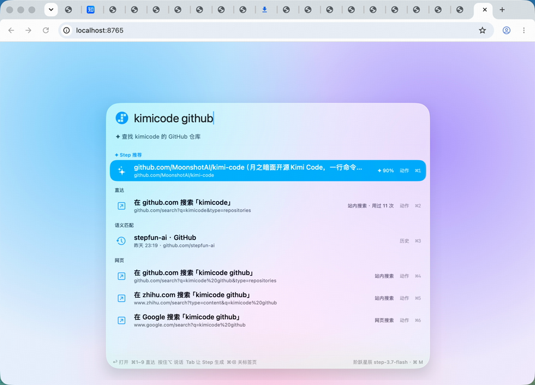

# StepBar · 阶跃星辰 Chrome AI 聚焦搜索

StepBar 是一个常驻 macOS 菜单栏的 Chrome 搜索入口：按 **⌘M**，随口输入几个词或按住 **⌥** 说一句话，它会在你的标签页和浏览历史里找到要去的页面；本地没有的，就由阶跃星辰模型结合联网搜索直接生成目标地址。

它只做一件事：**把你带到要去的网页**。不聊天，不读屏幕，不碰 Chrome 以外的应用。用得越久，它越了解你常去的网站和习惯。



## 效果演示

以下演示都是在真实 Chrome 中录制的，未修改结果内容。

| 联网获取最新信息：直达官方仓库 | 点名站点：直接站内搜索 |
|---|---|
|  |  |
| 输入 `kimicode github`。StepBar 从联网摘要里摘出官方地址，直接打开 `github.com/MoonshotAI/kimi-code`。 | `小红书 国庆去哪里玩`：从没在小红书搜过也能构造站内搜索地址。目标站点可能要求登录。 |
| **一句话提问：知乎搜索** | **语义匹配：换个说法也能找回** |
|  |  |
| `大模型会不会让程序员失业 知乎`：去掉站名，只把问题带进知乎搜索。 | `阶跃 api 是啥`：标题里没有这几个字，靠后台为页面写的用途和关键词，找回看过的「基本概念」文档。 |
| **越用越懂你** | |
|  | |
| 只输入 `deeps`，直接给出上次选过的 DeepSeek GitHub 搜索页。 | |

## 工作方式

每次唤起，结果分三层逐步给出：

1. **历史匹配**（本机，约 1 ms）：按标题和网址匹配标签页与 Chrome 历史，加上以前同一输入选过的页面、学到的查询入口和站内搜索。
2. **语义匹配**（本机，约 1 ms）：后台模型事先为每个页面写好用途、中英文关键词和常见问法，换个说法也能命中。
3. **✦ Step**（停止输入 150 ms 后）：先用输入的词联网搜索一次，再把前两层的候选、联网结果、当前标签页、剪贴板和学到的网址模式一起交给 `step-3.7-flash`。模型挑出答案，必要时直接生成目标网址。

平时空闲且接通电源时，`step-5-preview` 在后台用高推理强度阅读你访问过的页面，写下页面用途，并归纳各网站的网址结构（例如 `github.com/{owner/repo}`、`zhihu.com/search?q={关键词}`）。唤起面板时，后台任务会立刻让出网络和额度。

详细设计见 [产品设计](docs/PRODUCT.md) 和 [技术实现](docs/ARCHITECTURE.md)。

## 安装

需要 macOS 13 及以上、Swift 5.9 及以上工具链（Xcode 或 Command Line Tools）、Google Chrome，以及一个 [StepFun Step Plan](https://platform.stepfun.com/) Key。

```sh
git clone https://github.com/liuedcson/hackathon-StepBar.git
cd hackathon-StepBar

# 1. 配置 Key：复制模板，在两处 apiKey 填入 Step Plan Key
cp config.example.json config.local.json
chmod 600 config.local.json

# 2. 可选，只需一次：创建本机固定签名，重新构建后麦克风授权不会失效
./scripts/setup-signing.sh

# 3. 构建并启动
./scripts/build.sh
open build/StepBar.app
```

`config.local.json` 已被 `.gitignore` 忽略。其中 `summary` 是后台模型（step-5-preview），`quick` 是唤起时的模型（step-3.7-flash），两者都使用 `https://api.stepfun.com/step_plan/v1`。

### 在设置中配置模型

菜单栏 →「设置」→「模型配置」：

- **官方 · StepFun Step Plan**：地址固定为官方 Step Plan；后台记忆和前台检索的 Model ID 分别填写，共用一个 Step Plan Key。
- **自定义 · OpenAI 兼容协议**：后台记忆、前台检索分别填写 Base URL、Model ID 和 API Key，可使用不同服务。Base URL 通常以 `/v1` 结尾，也可填写完整 `/chat/completions` 地址；本机服务支持 HTTP，其他地址要求 HTTPS。
- API Key 留空保留已保存值；可以单独删除。保存后立即生效，点击「测试已保存的 AI 配置」会分别测试后台和前台，不发送浏览历史。
- 联网搜索和语音是官方 Step Plan 专用接口，使用另行保存的 Step Plan Key；自定义服务的密钥不会发给它们。没有官方 Key 时跳过联网搜索，语音提示配置，其他检索功能仍可用。

自定义模式不发送 Step 专用推理参数；支持 JSON 输出的服务可开启「请求 JSON 输出模式」。官方和自定义配置分别保留，切换模式不会覆盖另一套 Key。

### 安装 Chrome 扩展

扩展负责上报标签页、切换和关闭标签页，并读取你停留过的页面正文（无痕窗口除外），让后台更好地理解页面。

1. 打开 `chrome://extensions`，开启右上角「开发者模式」；
2. 点「加载已解压的扩展程序」，选择仓库里的 `browser-extension` 文件夹；
3. 扩展会读取构建时生成的 `browser-extension/pairing.json` 自动配对。重新构建后，在扩展页点一下「重新加载」。

不装扩展也能用，这时只搜索 Chrome 历史。

## 使用

| 操作 | 说明 |
|---|---|
| ⌘M | 唤起或关闭面板 |
| 输入 | 实时显示本机结果，停顿后 ✦ Step 结果置顶 |
| 按住 ⌥ | 说话输入，由 `stepaudio-2.5-asr` 转写 |
| ↑ ↓ / ↩ | 选择 / 打开；已打开的页面切换到原标签页 |
| ⌘1–9 | 直接打开第 N 项 |
| Tab | 让 Step 再生成一次动作 |
| ⌘⌫ | 关闭选中的标签页 |
| Esc | 先清空输入，再按一次关闭面板 |

不输入直接 ⌘M 时，显示和剪贴板相关的建议以及最近的页面。

菜单栏里的「Step 的理解与记忆」窗口可以查看后台写下的页面理解、网址模式、学到的查询入口和选择，也可以逐条删除或修改设置。

## 越用越好用

- **记住选择**：同一个输入选过的页面会置顶；选过两次以上，就不再调用模型。
- **学会站内搜索**：在某个网站搜过之后，下次「站名 + 关键词」直接在那里搜；GitHub、知乎、小红书、B 站等常见网站内置了搜索入口。
- **学会查询入口**：复制一个 ID 后两分钟内打开了含这个 ID 的网址，下次复制新 ID 唤起，就能直达从没访问过的对应页面。
- **理解页面**：后台持续为新页面写用途和关键词，语义匹配会越来越准。

## 隐私

- 所有记忆保存在本机 `~/Library/Application Support/StepBar/`，可在诊断窗口查看和删除。
- 联网搜索只发送你输入的词，不发送剪贴板、页面内容或历史。回忆类输入（「上周看的…」）、链接，以及含订单号、长 ID 或疑似密钥的输入不会联网。
- 发给模型前统一脱敏：手机号、邮箱、证件号会被替换，疑似密钥的剪贴板内容整段丢弃，带 token、session 等敏感参数的网址整条不发送。
- 不截图，不读取屏幕，不读取无痕窗口。可在设置里排除域名、关闭后台理解或联网搜索。
- 浏览器桥接只监听 `127.0.0.1:17373`，每个请求都要带配对码。

## 开发

```sh
./scripts/test.sh     # 单元测试与桥接测试
./scripts/build.sh    # 构建 build/StepBar.app

# 命令行诊断（需要 config.local.json）
.build/release/StepBar --search-check "阶跃 api 是啥"   # 逐层打印候选、联网结果、模型输出和耗时
.build/release/StepBar --model-bench "q1" "q2"          # 多个查询的端到端耗时
.build/release/StepBar --understand 1                   # 跑一轮后台页面理解与网址模式归纳
.build/release/StepBar --eval-search                    # 用本机搜索日志计算命中率
```

## 许可

本项目为 Hackathon 作品，暂未附带开源许可证。

当前限制：联网摘要可能不完整，模型生成的目标地址仍可能失效；部分站点需要登录。语音功能已保留，但当前版本完整语音链路尚未验收。
