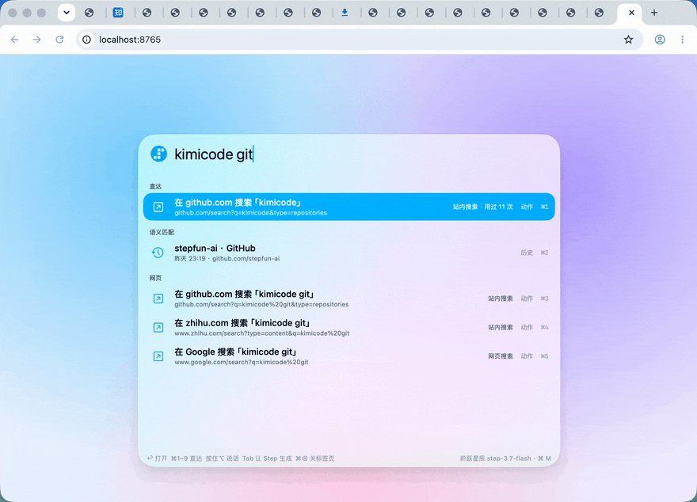
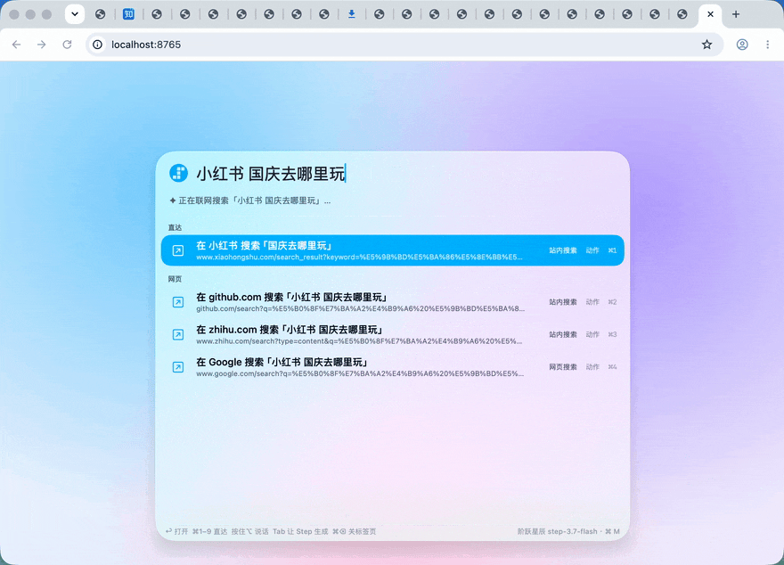
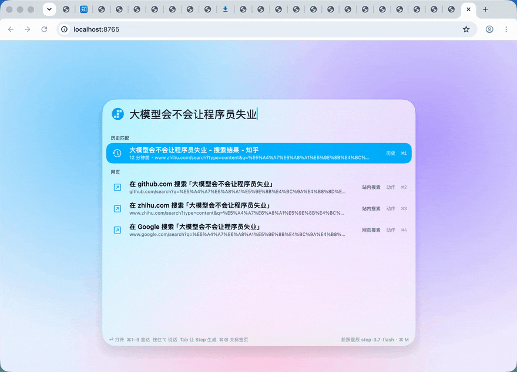
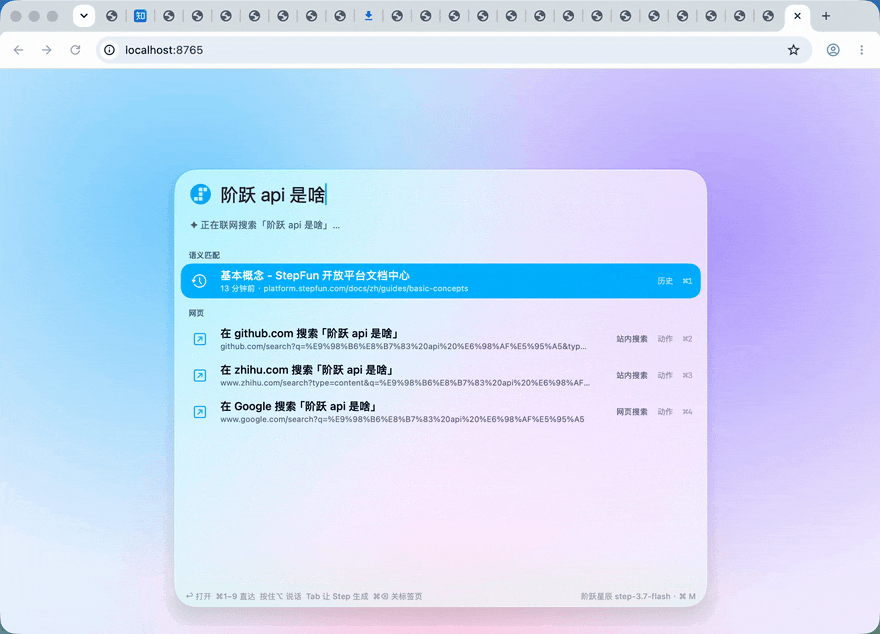
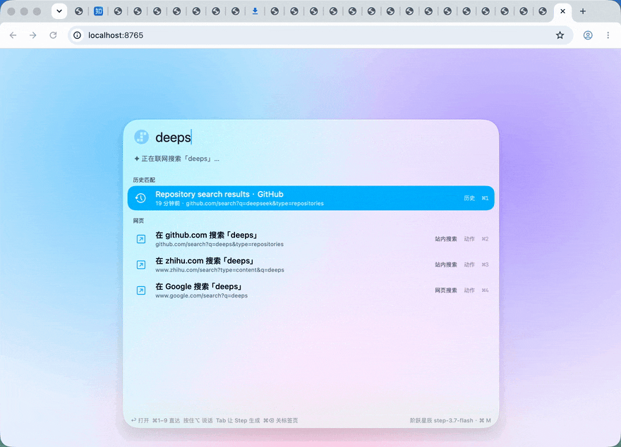

# StepBar · 让整个 Mac 越用越懂你

StepBar 的愿景是成为 **macOS 生态级的工作伙伴**：连接你授权的应用，理解当下的工作上下文，整理常用的工作路径，学习不同工具之间的组合，在你唤起时给出最合适的下一步。

**不只是“找到一个东西”，而是“知道你接下来要做什么”。**

## 核心理念：从上下文，到下一步

办公不是一组孤立的搜索，而是一条跨应用的工作路径：看到消息、了解问题、查找资料、打开工具、继续处理。StepBar 希望在用户授权下连接这些上下文，逐渐学会“什么情况下，你通常会去哪、做什么”，把常用路径整理成可复用的组合。

有时，你知道想找什么，却记不起它叫什么。

浏览器开了几十个页面，标签越来越窄。你记得之前看过一篇讲强化学习（RL）的博客，解释得很好，却忘了标题、网站和打开的时间。

不必逐个翻标签，也不必猜关键词。唤起 StepBar，说一句：

“之前看的那篇讲 RL 的博客，里面解释了奖励模型。”

StepBar 要做的，不只是匹配标题，而是理解页面讲了什么、对你有什么用，让你用记忆里的描述找回它。你记住的是内容和意义，不应该被迫记住网址。

更进一步，你可能连下一步要打开什么，都不必重新寻找。

在未来的跨应用场景中，团队消息出现一条服务告警，授权应用通过 MCP 提供必要上下文。StepBar 结合过去的处理习惯，把相关指标页、日志查询和排查文档整理成建议。按 ⌘M，即可选择对应入口，继续工作。

从“帮我找到之前看过的东西”，到“帮我接上现在要做的事情”——这就是 StepBar 想走的路。

浏览器是起点，不是终点。让整个 Mac 越用越懂你，让下一步少一点寻找，多一点顺手。


## 初步实现

受 Hackathon 时间与技术条件限制，**v0.1.0 先实现 Chrome 场景**：按 **⌘M**，输入几个词或使用已配置的语音，它会结合标签页、浏览历史、页面用途、剪贴板和过去的选择，找到或生成目标网页入口。默认使用阶跃星辰 Step Plan，也支持自定义服务。

这一版验证的是愿景里的基础闭环：**获取上下文 → 理解用途 → 学习路径 → 推荐入口 → 从选择中继续学习**。目前不读取其他应用或本地文件，不截图、不读屏幕；跨应用 MCP、工作路径组合和跨应用下一步预测均属于后续规划，不是当前已交付能力。

我们希望未来的 macOS 应用能通过 **MCP（Model Context Protocol）或适配器** 与 StepBar 保持连接，按权限共享必要信息与操作能力。这个愿景不是持续监视整个 Mac：接入范围、共享信息、记忆和执行权限必须由用户控制。


## 效果演示

以下演示都是在真实 Chrome 中录制的，未修改结果内容。

### 联网获取最新信息，直达官方仓库

输入 `kimicode github`，从联网摘要中找到官方地址，直接打开 `github.com/MoonshotAI/kimi-code`，而不是一篇转载文章。

<p align="center">
  
</p>

### 点名站点，直接搜索

`小红书 国庆去哪里玩`：即使没在这个站点搜过，也能构造站内搜索地址。目标站点可能要求登录。

<p align="center">
  
</p>

### 一句话，把问题带到知乎

`大模型会不会让程序员失业 知乎`：去掉站名，只把问题带进知乎搜索。

<p align="center">
  
</p>

### 换个说法，也能找回

`阶跃 api 是啥`：标题里没有这些词，靠后台为页面写好的用途和关键词，找回看过的「基本概念」文档。

<p align="center">
  
</p>

### 记住你的选择，越用越懂你

只输入 `deeps`，上次选过的 DeepSeek GitHub 搜索页直接出现。熟悉的路径，不必每次重新寻找。

<p align="center">
  
</p>

## 当前版本的工作方式

每次唤起，结果分三层逐步给出：

1. **历史匹配**（本机，约 1 ms）：按标题和网址匹配标签页与 Chrome 历史，加上以前同一输入选过的页面、学到的查询入口和站内搜索。
2. **语义匹配**（本机，约 1 ms）：后台模型事先为每个页面写好用途、中英文关键词和常见问法，换个说法也能命中。
3. **✦ Step**（停止输入 150 ms 后）：先用输入的词联网搜索一次，再把前两层的候选、联网结果、当前标签页、剪贴板和学到的网址模式一起交给 `step-3.7-flash`。模型挑出答案，必要时直接生成目标网址。

平时空闲且接通电源时，`step-5-preview` 在后台用高推理强度阅读你访问过的页面，写下页面用途，并归纳各网站的网址结构（例如 `github.com/{owner/repo}`、`zhihu.com/search?q={关键词}`）。唤起面板时，后台任务会立刻让出网络和额度。

愿景、阶段边界和演进路径见 [产品设计](docs/PRODUCT.md)；当前实现及未来 MCP 连接设计见 [技术实现](docs/ARCHITECTURE.md)。

## 安装

### v0.1.1 安装包（无需 Swift 工具链）

需要 **macOS 13+、Apple Silicon（M 系列芯片）和 Google Chrome**。目前没有发布 Intel 安装包。

- [直接下载 StepBar-0.1.1-arm64.zip](https://github.com/liuedcson/hackathon-StepBar/releases/download/v0.1.1/StepBar-0.1.1-arm64.zip)
- [Release 页面与版本说明](https://github.com/liuedcson/hackathon-StepBar/releases/tag/v0.1.1)

源码与 Releases 公开，无需 GitHub 登录或 Token。不要从不明来源下载。

1. 下载 ZIP 并解压，得到 `StepBar.app`。
2. 将应用移到 `/Applications`，或自己的 `~/Applications` 文件夹，再双击打开。不要一直从下载目录运行。
3. 首次启动若被系统拦截，按照下节步骤放行。
4. 启动后在 **屏幕顶部菜单栏** 找到 StepBar 图标。它没有普通应用的主窗口，不出现 Dock 图标属于正常行为。
5. 打开菜单栏 →「设置」，填写官方 Step Plan Key，或配置自定义后台／前台服务，保存后点击「测试已保存的 AI 配置」。安装包不含 Key，也不会自动读取源码旁的 `config.local.json`。
6. 按下文安装 Chrome 扩展并验证连接，最后按 **⌘M** 开始搜索。不配置模型也能先用本地检索。

### 首次启动：Apple 无法验证 StepBar

当前使用本机固定签名，**没有 Developer ID 签名与 Apple 公证**。提示“Apple 无法验证 StepBar 是否包含恶意软件”表示系统无法验证开发者与公证状态，不等于已检测到恶意软件；也不能据此保证应用安全。只在确认安装包来源可信后放行。

1. **尝试打开一次 StepBar**，让系统显示拦截提示。
2. 前往 **系统设置 → 隐私与安全性**。
3. 向下滚动到「安全性」，找到“已阻止 StepBar 以保护 Mac”的提示，点击 **仍要打开**。
4. 输入系统密码或使用 **Touch ID**，再确认打开。

如果没有“仍要打开”：重新尝试打开一次应用，然后回到该页面检查。受组织管理的 Mac 可能禁止放行，需要联系管理员。若提示明确指出“会损坏电脑”、检测到恶意软件或应用已损坏，不应按此方法绕过；停止运行并核对安装包。

**不需要关闭 Gatekeeper、修改全局安全设置、开启完全磁盘访问或辅助功能权限。** 麦克风权限仅在启用并使用语音时按需申请。未来正式分发需要 Developer ID 签名、Hardened Runtime 和 Apple 公证；本版尚未完成。

### 自动检查更新

设置 →「版本与更新」，默认启动时和每 6 小时自动检查公开 GitHub Releases，无需 Token。可关闭自动检查；发现新版本后确认下载、验证并安装重启，不静默安装。

GitHub Releases 保存 ZIP 和 `update-arm64.json`（版本、文件名、架构、SHA-256）。匿名请求固定 GitHub API，只接受允许的 GitHub HTTPS 资源重定向。校验包摘要、版本、Bundle ID 和与当前应用相同的签名身份，不通过则不安装。以后版本必须使用同一签名证书；网络故障或匿名 API 限流时可手动下载。更新后 Chrome 扩展需重新加载。旧版 v0.1.0 的更新界面仍需要 Token，建议先手动安装 v0.1.1。

### 从源码构建

额外需要 Swift 工具链（Xcode 或 Command Line Tools）。配置也可以直接在应用设置中填写；使用本机配置文件的开发者可按以下流程配置。

```sh
git clone https://github.com/liuedcson/hackathon-StepBar.git
cd hackathon-StepBar

# 1. 配置 Key：复制模板，在两处 apiKey 填入 Step Plan Key
cp config.example.json config.local.json
chmod 600 config.local.json

# 2. 可选，只需一次：创建本机固定签名，重新构建后麦克风授权不会失效
./scripts/setup-signing.sh

# 3. 构建并启动
./scripts/build.sh
open build/StepBar.app
```

`config.local.json` 已被 `.gitignore` 忽略。其中 `summary` 是后台模型（step-5-preview），`quick` 是唤起时的模型（step-3.7-flash），两者都使用 `https://api.stepfun.com/step_plan/v1`。

### 在设置中配置模型

菜单栏 →「设置」→「模型配置」：

- **官方 · StepFun Step Plan**：地址固定为官方 Step Plan；后台记忆和前台检索的 Model ID 分别填写，共用一个 Step Plan Key。
- **自定义 · OpenAI 兼容协议**：后台记忆、前台检索分别填写 Base URL、Model ID 和 API Key，可使用不同服务。Base URL 通常以 `/v1` 结尾，也可填写完整 `/chat/completions` 地址；本机服务支持 HTTP，其他地址要求 HTTPS。
- API Key 使用单行密码框显示已保存值，不明文展示；清空后保存即删除。保存后立即生效，点击「测试已保存的 AI 配置」分别以 `max_tokens=1` 检查后台和前台连通性，不生成业务内容、不发送浏览历史；不代表搜索、语音或 JSON 输出均已验证。
- 官方模式的搜索和语音使用 Step Plan；**自定义模式完全不调用 Step Plan**。自定义搜索默认关闭，可选择 Bing 等搜索引擎入口（仅点击后打开，不提供模型上下文），或配置独立的搜索 JSON API（完整 URL、独立 Key，POST `{query,n}`，返回 `{results:[{title,url,snippet,time?}]}`）。
- 自定义语音默认关闭。需要时配置 OpenAI 兼容音频转写接口的完整 URL（如 `https://asr.example/v1/audio/transcriptions`）、Model ID 和独立 Key。发送 multipart WAV，返回 `{text}`。未启用或未配置完整时不录音、不请求麦克风权限；不支持此协议的服务请保持关闭。

自定义模式不发送 Step 专用推理参数；支持 JSON 输出的服务可开启「请求 JSON 输出模式」。官方和自定义配置分别保留，切换模式不会覆盖另一套 Key。

### 安装 Chrome 扩展

**扩展就在 Git 仓库里：[browser-extension/](browser-extension/)。** 文件包括 `manifest.json`、`background.js`、配对设置页和图标。`pairing.json` 是每台机器生成的私有配对码，故意不提交到 Git，不能共用或上传。

**方式一：使用安装包（推荐，不需要下载源码）**

1. 先启动 StepBar，保持菜单栏应用运行。
2. 点击菜单栏 → **设置 → Chrome 扩展 → 安装 Chrome 扩展**。应用会准备扩展资源，在 Finder 中选中文件夹，并尝试打开 Chrome 扩展页。
3. 在 Chrome 地址栏输入 `chrome://extensions`，打开右上角 **开发者模式**。
4. 点击 **加载已解压的扩展程序**，选择 Finder 中的 `StepBar-browser-extension` 文件夹。不是选择 ZIP、`.app` 或某个 JS 文件。
5. 如果找不到文件夹：在选择窗口按 **⌘⇧G**，粘贴 `~/Downloads/StepBar-browser-extension`，再选中它。
6. 扩展会读取该目录里的本机配对码自动连接。这个目录需长期保留；不要加载后删除或移动。

v0.1.1 会将可加载的扩展准备到下载目录；再次点击可刷新文件，再在 Chrome 中点「重新加载」。旧版 v0.1.0 仍使用 `~/Library/Application Support/StepBar/browser-extension`，从旧版升级请移除旧扩展并加载新目录。

**方式二：从 Git 仓库加载扩展**

1. 克隆仓库或在 GitHub 选择 **Code → Download ZIP** 并解压。
2. 在 `chrome://extensions` 开启开发者模式，加载源码中的 `browser-extension/` 文件夹。
3. 打开 StepBar →「设置」→「Chrome 扩展」，确认已启用本机 Chrome 桥接，复制配对码。
4. 在 Chrome 工具栏点扩展图标（找不到时点拼图图标），打开配对页，粘贴配对码并点击 **保存并连接**。也可从扩展详情进入「扩展程序选项」。源码目录默认没有你的配对文件，所以需要手动配对。

**如何确认安装成功**

- Chrome 扩展列表里能看到 **StepBar for Chrome**，且启用开关已打开。
- 扩展配对页显示「已连接」；StepBar 设置里的桥接状态更新，出现标签页信息。
- 打开两个公开网页，按 ⌘M 搜索其中一个的标题。选中已经打开的标签页后，应切回原标签页。

连接失败时，检查 StepBar 是否正在运行、桥接是否开启和配对码是否一致；重新生成配对码后，重新加载扩展或手动保存新配对码。升级应用后在 `chrome://extensions` 点扩展的 **重新加载**；从头重装时移除旧扩展，再加载新目录，避免重复扩展。

扩展上报标签页、读取停留页面的正文摘录，并执行切换／关闭标签页；不读取无痕窗口。**不装扩展也能搜索 Chrome 历史，但没有扩展提供的标签页上下文、切换／关闭和页面正文能力。**

完整重装、验收与故障排查见 [安装与使用指南](docs/INSTALL.md)。

## 使用

**唤起与输入**

- **⌘M** — 唤起或关闭面板。
- **输入** — 本机结果实时出现，停顿后 ✦ Step 结果置顶。
- **按住 ⌥** — 使用已配置的语音服务说话输入；官方默认由 `stepaudio-2.5-asr` 转写。

**选择与打开**

- **↑ ↓ / ↩** — 选择并打开；已打开的页面切换到原标签页。
- **⌘1–9** — 直接打开第 N 项。
- **Tab** — 让 Step 再生成一次动作。

**退出与整理**

- **⌘⌫** — 关闭选中的标签页。
- **Esc** — 先清空输入，再按一次关闭面板。

不输入直接 ⌘M 时，显示和剪贴板相关的建议以及最近的页面。

设置 →「运行信息」→「查看 Step 的理解与记忆」，可以查看后台写下的页面理解、网址模式、学到的查询入口和选择，也可以逐条删除。菜单栏只保留设置、暂停／恢复和退出。

## 越用越好用

- **记住选择**：同一个输入选过的页面会置顶；选过两次以上，就不再调用模型。
- **学会站内搜索**：在某个网站搜过之后，下次「站名 + 关键词」直接在那里搜；GitHub、知乎、小红书、B 站等常见网站内置了搜索入口。
- **学会查询入口**：复制一个 ID 后两分钟内打开了含这个 ID 的网址，下次复制新 ID 唤起，就能直达从没访问过的对应页面。
- **理解页面**：后台持续为新页面写用途和关键词，语义匹配会越来越准。

## 隐私

- 所有记忆保存在本机 `~/Library/Application Support/StepBar/`，可在诊断窗口查看和删除。
- 联网搜索只发送你输入的词，不发送剪贴板、页面内容或历史。回忆类输入（「上周看的…」）、链接，以及含订单号、长 ID 或疑似密钥的输入不会联网。
- 发给模型前统一脱敏：手机号、邮箱、证件号会被替换，疑似密钥的剪贴板内容整段丢弃，带 token、session 等敏感参数的网址整条不发送。
- 不截图，不读取屏幕，不读取无痕窗口。可在设置里排除域名、关闭后台理解或联网搜索。
- 浏览器桥接只监听 `127.0.0.1:17373`，每个请求都要带配对码。

## 开发

```sh
./scripts/test.sh     # 单元测试与桥接测试
./scripts/build.sh    # 构建 build/StepBar.app

# 命令行诊断（需要 config.local.json）
.build/release/StepBar --search-check "阶跃 api 是啥"   # 逐层打印候选、联网结果、模型输出和耗时
.build/release/StepBar --model-bench "q1" "q2"          # 多个查询的端到端耗时
.build/release/StepBar --understand 1                   # 跑一轮后台页面理解与网址模式归纳
.build/release/StepBar --eval-search                    # 用本机搜索日志计算命中率
```

## 许可

本项目为 Hackathon 作品，暂未附带开源许可证。

当前限制：联网摘要可能不完整，模型生成的目标地址仍可能失效；部分站点需要登录。官方语音已通过三段合成语音的真实转写与本地搜索测试；麦克风权限、按键录音与自定义真实语音服务仍需现场验收。发布后的源码修复了中文语音省略空格时的站内搜索，现有 v0.1.0 安装包不包含此修复。
